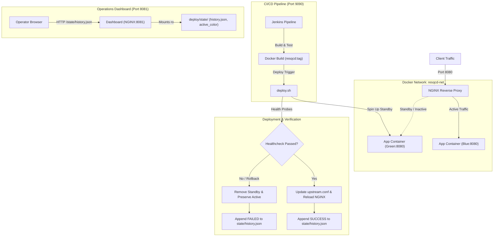

# ResQ-CD: Zero-Downtime Blue-Green Deployment & Automated Recovery

ResQ-CD is an automated, continuous deployment system designed to eliminate production downtime and deployment risk. Leveraging an active-standby Blue-Green deployment architecture with automated pre-routing health checks and instant fallback mechanisms, ResQ-CD ensures that faulty releases never impact live user traffic while broadcasting real-time deployment metrics to an operations dashboard.

---

## Architecture Diagram



---

## Tech Stack

- **Application Backend:** Java 17, Spring Boot, Spring Boot Actuator
- **Reverse Proxy & Routing:** NGINX (Dynamic reload via upstream configuration)
- **Containerization:** Docker & Docker Compose
- **CI/CD Pipeline:** Jenkins (Declarative Pipeline with parameterized builds)
- **Automation Engine:** Bash scripting (Automated health verification and blue-green orchestration)
- **Monitoring & Metrics:** Vanilla HTML5, CSS3, JavaScript (Real-time auto-refreshing dashboard)

---

## How to Run

### Prerequisites
- Docker & Docker Compose installed
- Git Bash or standard Bash shell

### 1. Initialize Network
Ensure the shared external network exists:
```bash
docker network create resqcd-net || true
```

### 2. Start Routing & Dashboard Services
Start both the reverse proxy (port 8080) and dashboard (port 8081):
```bash
docker compose -f deploy/docker-compose.yml up -d
```

### 3. Service Endpoints
- **Application Gateway (NGINX):** [http://localhost:8080](http://localhost:8080)
- **Application Health:** [http://localhost:8080/actuator/health](http://localhost:8080/actuator/health)
- **Jenkins CI/CD:** [http://localhost:9090](http://localhost:9090)
- **Deployment Dashboard:** [http://localhost:8081](http://localhost:8081)

---

## Demo Steps

### 1. Normal Build (Successful Deployment)
1. Open Jenkins at [http://localhost:9090](http://localhost:9090).
2. Select the `ResQ-CD` pipeline and click **Build with Parameters**.
3. Leave `INJECT_FAILURE` unchecked (`false`) and trigger the build.
4. **Outcome:**
   - Standby container launches and passes 10 consecutive health checks.
   - NGINX reloads seamlessly to point to the new container.
   - Active color switches (e.g. `blue` &rarr; `green`).
   - Old container is decommissioned after post-switch verification.
   - `history.json` logs `SUCCESS`.
   - The dashboard updates in real time to reflect increased deploy count and success rate.

### 2. Failure Injection Build (Automated Rollback & Zero Downtime)
1. In Jenkins, click **Build with Parameters**.
2. Check the **`INJECT_FAILURE`** parameter (`true`) and trigger the build.
3. **Outcome:**
   - Standby container starts with `BREAK_HEALTH=true`, simulating an application crash or broken dependency.
   - Pre-routing health check fails to reach `/actuator/health`.
   - Deployment script immediately stops and removes the broken standby container.
   - Live traffic on [http://localhost:8080](http://localhost:8080) is completely unaffected and continues serving users without interruption.
   - `history.json` records `FAILED_HEALTHCHECK`.
   - The dashboard updates to display the failure and maintains historical tracking.

---

## Screenshots

<!-- Placeholder: Replace with actual system captures -->

### Real-Time Deployment Dashboard

*Real-time metrics: Total Deploys, Success Rate, Failed/Rollback Counts, and historical audit log.*

### Jenkins CI/CD Pipeline

*Automated multi-stage pipeline: Checkout, Maven Test, Docker Build, and Zero-Downtime Deploy.*

### Zero-Downtime Traffic Verification

*Continuous traffic validation during active version transition and failure isolation.*

---

## Resume Line

- **Engineered an automated zero-downtime Blue-Green deployment pipeline using Docker, NGINX, and Jenkins, featuring automated health verification, instant failure rollback, and a real-time observability dashboard.**
